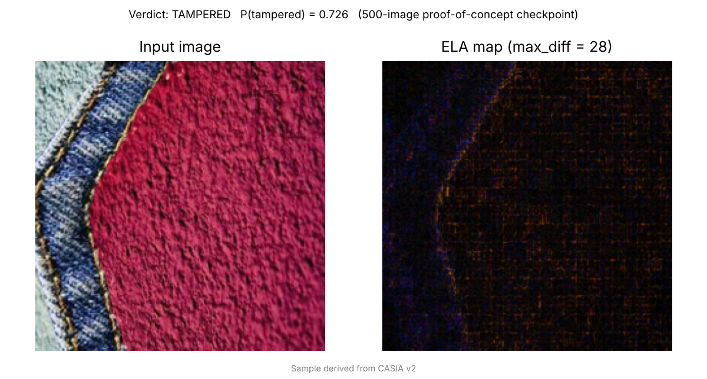
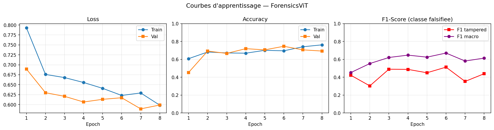

# ForensicsViT

Image tampering detection with a Vision Transformer that looks at **RGB and Error Level Analysis (ELA) at the same time**.

Academic project for the *Image Processing and Recognition* module (ISMAGI, cybersecurity engineering track, 2025-2026).
The model is a **proof of concept** trained on a 500-image subset of CASIA v2, on CPU. See [Results](#results) for what
that does and does not show.



## How it works

```
image ──► ELA map  (JPEG re-save at quality 95, difference amplified)
  │            │
  └─ RGB (3 ch) + ELA (3 ch) ──► 6-channel tensor, 224 x 224
                                  └─► ViT-B/16 with a 6-channel patch embedding
                                       └─► [CLS] token ─► dropout 0.3 ─► linear 768 → 2
                                            └─► authentic / tampered
```

- **ELA.** A tampered region often has a different JPEG compression history from the rest of the image. Re-saving the
  image at a known quality and amplifying the difference makes those regions brighter.
- **6-channel ViT.** The backbone is `vit_base_patch16_224` from `timm`. Its first projection layer is extended from
  3 to 6 channels and the 3 new ELA channels are initialised with the pretrained RGB weights (partial transfer learning).
- **Training.** Two phases: backbone frozen (lr 1e-3), then full fine-tuning (lr 1e-5). Batch size 8 with gradient
  accumulation x4. The loss is class-weighted because CASIA v2 is imbalanced (7,491 authentic vs 1,827 tampered images).
- **Forensic report.** For each analysed image the tool writes a PNG and a JSON with the verdict, both probabilities,
  the ELA maximum difference and the **SHA-256 of the file** (chain of custody).

## Results

Quick mode: 500 images, 8 epochs (3 frozen + 5 fine-tuning), about 2 h 42 min on CPU.

| Metric | Authentic | Tampered | Macro avg |
|---|---|---|---|
| Precision | 0.861 | 0.429 | 0.645 |
| Recall | 0.795 | 0.545 | 0.670 |
| F1-score | 0.827 | 0.480 | 0.653 |

Accuracy **74.0 %**, AUC-ROC **0.711**.

This is a preliminary result on a small held-out set. The model separates the two classes better than chance but misses
or mislabels many tampered images (F1 0.48), so treat it as a working pipeline rather than a competitive detector.
A full training on the 9,318 CASIA v2 images is the next step and is **not** reported here.



Raw numbers: [`reports/training_results.json`](reports/training_results.json).

## Known limitations

- **The Grad-CAM overlay is currently uninformative (flat map).** The hook is on the MLP of the last transformer block,
  but the classifier only reads the `[CLS]` token, so the patch tokens at that layer probably receive no gradient. The
  planned fix is to hook the input of the last attention block and average the gradients over the tokens. Until then, rely
  on the ELA map and the probabilities.
- **Small training set** (500 images, CPU), see above.
- **Dataset bias.** CASIA v2 (2013) contains classical splicing and copy-move edits, not modern generative-AI edits, and
  no cross-dataset evaluation was done.
- **ELA depends on JPEG artefacts.** It is much weaker on PNG images or images that were recompressed several times.
- **No pretrained weights are published** and the front-end folder `demo_ui/` used by `app.py` is not part of this
  repository yet (the `POST /analyze` endpoint works without it).

## Project structure

```
src/
  ela_generator.py   ELA maps, SHA-256, batch processing
  dataset.py         CASIA v2 dataset, 6-channel tensors, train/val/test loaders
  model.py           ForensicsViT (ViT-B/16, 6 input channels)
  train.py           Two-phase training
  evaluate.py        Test-set metrics, single-image forensic report, Grad-CAM
app.py               Flask API (POST /analyze) for a local demo
check_env.py         Checks that the dependencies import correctly
reports/             Training curves, metrics, example output
```

## Getting started

```bash
git clone https://github.com/clouds-K/forensics-vit
cd forensics-vit
python -m venv venv
venv\Scripts\activate          # Windows (Linux / macOS: source venv/bin/activate)
pip install -r requirements.txt
python check_env.py
```

**1. Get the dataset.** Download CASIA v2 (for example from
[Kaggle](https://www.kaggle.com/datasets/sophatvathana/casia-dataset)) and arrange it like this:

```
data/raw/authentic/   original images
data/raw/tampered/    tampered images
```

**2. Generate the ELA maps** (written to `data/ela/`):

```bash
python src/ela_generator.py
python src/ela_generator.py test path/to/image.jpg    # ELA + SHA-256 for a single image
```

**3. Train** (the best checkpoint is saved to `checkpoints/best_model.pt`):

```bash
python src/train.py          # quick mode, 500 images
python src/train.py --full   # whole dataset
```

**4. Evaluate and analyse**

```bash
python src/evaluate.py                          # metrics on the test split
python src/evaluate.py --image path/to/image.jpg   # forensic report (PNG + JSON) in reports/
```

Example JSON report:

```json
{
  "filename": "example.jpg",
  "sha256": "04ee9a54...",
  "prediction": "AUTHENTIC",
  "prob_authentic": 0.9566,
  "prob_tampered": 0.0434,
  "ela_max_diff": 14.0,
  "verdict": "AUTHENTIQUE",
  "confiance": 95.7
}
```

**5. Local demo API**

```bash
python app.py     # http://localhost:5000, POST an image to /analyze
```

## Dataset and credits

CASIA v2: Dong, Wang and Tan, *CASIA Image Tampering Detection Evaluation Database*, 2013. The dataset has its own terms
of use (research); it is not redistributed here. The example figure is derived from one of its images.

## Author

**Khouloud Moumni**, cybersecurity engineering student at ISMAGI (Morocco), class of 2027.
[GitHub](https://github.com/clouds-K)

## License

[MIT](LICENSE)
